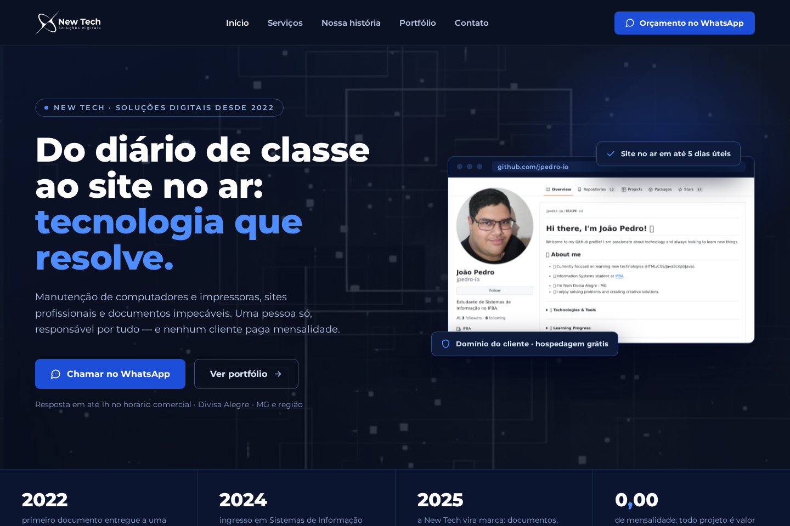

<p align="center">
  
</p>

<p align="center">
  <strong>Site institucional da New Tech</strong> — tecnologia que resolve em Divisa Alegre - MG.<br>
  Do diário de classe ao site no ar: manutenção, sites, documentos acadêmicos e automações.
</p>

<p align="center">
  
  
  
  
  
</p>

<p align="center">
  
</p>

---

## 📌 Sobre o projeto

Página única institucional da **New Tech — Soluções digitais**, construída como réplica fiel
da UI design aprovada (prancha em 1440px). Apresenta os serviços, a história da marca
(nascida em 2022 fazendo documentos para professores de Divisa Alegre), a stack técnica
e o portfólio de projetos reais no ar — com chamada direta para orçamento no WhatsApp.

## 🧩 Seções da página

| # | Seção | O que mostra |
|---|-------|--------------|
| 1 | **Nav** | Logo da marca, menu âncora e CTA "Orçamento no WhatsApp" |
| 2 | **Hero** | H1 "Do diário de classe ao site no ar: tecnologia que resolve.", mockup de navegador com o GitHub real e chips flutuantes |
| 3 | **Marcos** | 2022 → 2024 → 2025 → 0,00 de mensalidade |
| 4 | **Serviços** | 4 linhas numeradas: manutenção, sites, documentos & acadêmico, formulários |
| 5 | **Nossa história** | Narrativa em 1ª pessoa + timeline 2022–2026 assinada pelo fundador |
| 6 | **Stack técnica** | Frontend · Backend & dados · DevOps & deploy |
| 7 | **Projetos** | Redação com João (destaque), Gestão Tech e Portal Transporte Universitário, com screenshots reais |
| 8 | **Como funciona** | 4 passos: conversa → proposta → produção → entrega com garantia |
| 9 | **CTA** | Orçamento em 10 minutos no WhatsApp |
| 10 | **Footer** | Menu, logos sociais clicáveis e copyright |

## ✨ Destaques técnicos

- **Zero dependências e zero build** — HTML5 semântico, CSS3 e JavaScript vanilla.
- **Animações em duas camadas**: revelação em scroll com stagger (IntersectionObserver)
  e vida em *idle* (chips flutuando, glow no CTA, drift da textura de circuitos, brilho no H1).
- **Acessibilidade**: `prefers-reduced-motion` desliga todo movimento; contraste e foco cuidados.
- **Tipografia auto-hospedada**: Montserrat 300–800 via `@font-face` (sem CDN, sem FOUT de terceiros).
- **Identidade real da marca**: logos, ícone/favicon e textura de circuitos do guia de identidade New Tech.
- **Screenshots reais** dos projetos (Redação com João, Gestão Tech, Portal Transporte) e do perfil GitHub.
- **Responsivo**: 3 breakpoints (desktop 1440 → tablet → mobile).
- **Links vivos**: WhatsApp, portfólio, repositórios dos projetos, Instagram, LinkedIn e e-mail.

## 🗂️ Estrutura

```
.
├── index.html          # página única (todas as seções)
├── css/
│   └── style.css       # estilos, animações, responsivo, reduced-motion
├── js/
│   └── main.js         # reveal on scroll + estado do nav
├── assets/
│   ├── fonts/          # Montserrat 300–800 (.ttf auto-hospedada)
│   └── img/            # logos, favicon, textura, screenshots dos projetos
└── docs/
    └── preview.png     # prévia usada neste README
```

## 🚀 Projetos apresentados no site

| Projeto | Tipo | Stack | Link |
|---------|------|-------|------|
| **Redação com João** | Acadêmico · no ar | JS ES6 modular, IndexedDB, Vite | [redacaocomjoao.vercel.app](https://redacaocomjoao.vercel.app) |
| **Gestão Tech — Portal de Certificados** | Acadêmico · no ar | Django 5, PostgreSQL, Docker, Fly.io | [gestao-tech.fly.dev](https://gestao-tech.fly.dev) |
| **Portal Transporte Universitário** | Pessoal · no ar | Node.js puro, Open-Meteo, Vercel | [site-universitarios.vercel.app](https://site-universitarios.vercel.app) |
| **Portfólio completo** | — | — | [portfolio-ivory-eta-p7jmkacusy.vercel.app](https://portfolio-ivory-eta-p7jmkacusy.vercel.app) |

## 🎨 Identidade visual

Paleta oficial da marca: navy `#0F2D5F` · página `#0A1122` · painéis `#0E1B3A`/`#12224A` ·
acentos `#4D8DFF`/`#7FB0FF` · textos `#E8EEF9`/`#9DB9E8` · neve `#F8F9FA`.
Tipografia: **Montserrat** (300–800). Textura de circuitos como camada ambiente no hero e no CTA.

## 📞 Contato

- WhatsApp: [(33) 99847-8236](https://wa.me/5533998478236)
- E-mail: [jprocha.tech@gmail.com](mailto:jprocha.tech@gmail.com)
- Instagram: [@newtech_153](https://www.instagram.com/newtech_153/)
- GitHub: [jpedro-io](https://github.com/jpedro-io)
- LinkedIn: [João Pedro C. Rocha](https://www.linkedin.com/in/jo%C3%A3o-pedro-c-rocha-98ab7b3b5)

---

<p align="center">
  © 2026 <strong>New Tech — Soluções digitais</strong> · Divisa Alegre - MG<br>
  Feito por <strong>João Pedro Campos Rocha</strong> · fundador
</p>
